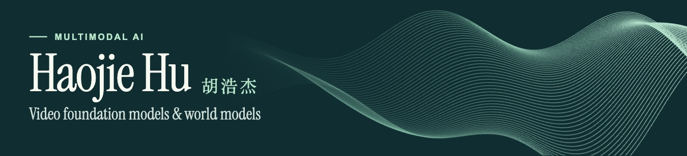

I study how video models connect **sound, motion, and memory**. I’m a research intern at **Tencent Video** and a software engineering undergraduate at **Tongji University**. In 2027, I’ll join **Shanghai Jiao Tong University** for a Ph.D. with joint training at the **Shanghai Innovation Institute**.

[Academic homepage](https://imhaojie.github.io/) · [Publications](https://imhaojie.github.io/#publications) · [Email](mailto:3038115521@qq.com)

### Research experience

**Tencent PCG / Tencent Video** · Research Intern, Video Foundation Models & World Models 
*October 2026 – present*

I contribute to **RallyVideo** training by evaluating the accuracy and consistency of training annotations. I also study how world models remember earlier events and how joint audio-video edits can keep sound and motion in sync.

[Research experience at Shanghai AI Laboratory, Tsinghua SIGS, and SJTU](https://imhaojie.github.io/#experience)

### Research & code

**[To Think or Not to Think](https://arxiv.org/abs/2610.21613)** · NeurIPS 2026, poster 
How much reasoning does a video clip need? Our controller chooses a reasoning budget before the first token. It retains about **96% of long-chain performance** at about **40% of the reasoning-token cost** in referring audio-visual segmentation. [Code](https://github.com/imhaojie/To-Think-or-Not-to-Think) · [Conference poster](https://neurips.cc/virtual/2026/poster/148558)

**[PosterMELD](https://arxiv.org/abs/2608.02218)** · Preprint 
Agents turn a paper into an editable, print-ready poster. They plan around each slot’s capacity and repair individual regions when a figure or caption doesn’t fit. [Code](https://github.com/Shannon4Science/PosterMELD) · [Project page](https://imhaojie.github.io/PosterMELD/)

**[Listening to the Motion](https://github.com/imhaojie/SKA-VCT)** · Under review 
We check whether an object’s motion follows the sound to identify what is actually making noise in a busy scene. [Code](https://github.com/imhaojie/SKA-VCT)

### Selected builds

| Project | What I built with the team |
| --- | --- |
| [**GameBuddy**](https://github.com/imhaojie/GameBuddy) | A basketball companion that checks commentary against game footage, official events, and statistics. Silver Award at NBA × AWS BroadcastCode in Macau. |
| [**DraftCode**](https://github.com/imhaojie/draftcode) | A draft simulator that models 30 NBA general managers and traces each pick through 1,500 Monte Carlo scenarios. Third place at the AWS Summit Shanghai hackathon. |
| [**VoxSprite**](https://github.com/imhaojie/VoxSprite) | A playable instrument made from a voice sample, a browser, and an ESP32-S3 keyboard with reactive lights. |
| [**Stardew-Valley**](https://github.com/imhaojie/Stardew-Valley) | A Cocos2d-x farming game with map interaction, collision detection, and inventory management. |

I work mainly with **Python and PyTorch** for research, and **TypeScript, C++, and AWS** for interactive systems. [Education and honors](https://imhaojie.github.io/#education)
